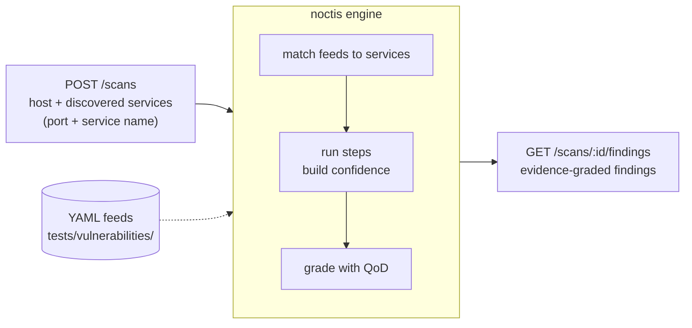

<p align="center">
  
</p>

<h1 align="center">noctis</h1>

<p align="center">
  <strong>A black-box vulnerability scanner driven by YAML feeds.</strong><br>
  Detects CVEs, misconfigurations and exposed services on live targets — with evidence, not version guesses.
</p>

<p align="center">
  <a href="https://github.com/fDarkShadow/noctis/actions/workflows/ci.yml"></a>
  <a href="LICENSE"></a>
  <a href="https://www.rust-lang.org"></a>
  <a href="https://github.com/fDarkShadow/noctis/pkgs/container/noctis"></a>
  <a href="https://buymeacoffee.com/fdarkshadow"></a>
</p>

<p align="center">
  <a href="#why-noctis">Why</a> ·
  <a href="#quick-start">Quick start</a> ·
  <a href="#run-with-docker">Docker</a> ·
  <a href="#rest-api">REST API</a> ·
  <a href="#writing-feeds">Writing feeds</a> ·
  <a href="#available-feeds">Feeds</a> ·
  <a href="#contributing">Contributing</a> ·
  <a href="#support">Support</a>
</p>

---

## Contents

- [Why noctis?](#why-noctis)
- [How it works](#how-it-works)
- [Features](#features)
- [Quick start](#quick-start)
- [Run with Docker](#run-with-docker)
- [REST API](#rest-api)
- [Writing feeds](#writing-feeds)
  - [Anatomy of a feed](#anatomy-of-a-feed)
  - [Automatic variables](#automatic-variables)
  - [Actions](#actions)
  - [Confidence / QoD scale](#confidence--qod-scale)
  - [`tcp_connect` vs `http_request`](#tcp_connect-vs-http_request)
  - [Validating a feed](#validating-a-feed)
- [Available feeds](#available-feeds)
- [Test infrastructure](#test-infrastructure)
- [Performance](#performance)
- [Requirements](#requirements)
- [Contributing](#contributing)
- [Support](#support)
- [License](#license)

---

## Why noctis?

Most network vulnerability scanners either **guess from version banners** — noisy and
false-positive-prone — or bury their detection logic in compiled code you can't read or audit.
noctis takes a different path:

- **Proof over guessing.** A finding is raised only when a step *observes* the vulnerable
  behaviour — an LFI response, an unauthenticated reply, an out-of-band callback — and every
  finding is graded with an OpenVAS-style **Quality-of-Detection (QoD)** score.
- **Detection as data.** Every check is a self-contained **YAML feed**, not compiled code. Read
  it, audit it, diff it in review, or write your own in minutes — no recompile.
- **No agent, no shared state.** Point it at live services over the network. Each feed is
  standalone and reproducible; there is no knowledge base to prime or poison.
- **One fast binary.** Rust, memory-safe, with a REST API built for automation and CI/CD, and a
  multi-arch container image a few MB in size.

If you've used **Nuclei** or **OpenVAS**, noctis sits between them — data-driven feeds like the
former, evidence-graded findings like the latter.

The table below is deliberately broad-strokes — each tool spans a range, and this is about
*positioning*, not a benchmark:

| Dimension | Version-based<br>(e.g. Nessus / OpenVAS) | Template-based<br>(e.g. Nuclei) | **noctis** |
|---|---|---|---|
| **Primary detection signal** | version / CPE inference | template request → matcher | **observed vulnerable behaviour** |
| **How a check is written** | compiled plugin / NASL | YAML template | **YAML feed (plain data)** |
| **Auditable in code review** | hard (compiled / large DSL) | easy (YAML) | **easy (YAML, one file per vuln)** |
| **Finding confidence** | QoD (OpenVAS) | match = hit | **QoD 0–100 per finding** |
| **False-positive posture** | higher (version guessing) | low–medium | **low — a step must prove it** |
| **Blind / out-of-band** | limited | yes (interactsh) | **built-in callback server** |
| **Protocol reach** | broad | HTTP + TCP / DNS / SSL / … | **HTTP, raw TCP / UDP, TLS, SSH, SNMP** |
| **Raw byte payloads** (encoded paths) | varies | yes (network templates) | **yes — verbatim, auto-TLS** |
| **Per-check scope** | one plugin | one template | **0..N CVEs + multi-step chains per feed** |
| **Shared state between checks** | knowledge base / cache | none | **none — every feed is self-contained** |
| **Runtime & integration** | scanner appliance / agent | Go binary | **Rust static binary + REST API** |
| **License** | OpenVAS GPL · Nessus proprietary | MIT | **MIT** |

**Where noctis shines:** evidence-graded findings you can trust in a pipeline, checks that read
like data in a pull request, and first-class non-HTTP coverage. **Where the others still win
today:** raw plugin/template count — mature scanners ship tens of thousands of checks; noctis's
feed set is smaller and growing.

---

## How it works



You give noctis a host and the services discovered on it (e.g. from an nmap scan: a port + a
service name). The engine selects every feed whose declared `services:` match, runs each feed's
steps against the live service, and returns findings graded by how strong the evidence is.

---

## Features

**Available today**

- [x] **YAML feeds** — one file per vulnerability (0, 1, or several CVEs); steps, patterns, confidence deltas
- [x] **Service-aware matching** — feeds declare `services:` (`http`, `https`, `ssh`, `ftp`…); the engine maps them to discovered ports
- [x] **HTTP/HTTPS** probes (reqwest) and **raw TCP** with verbatim byte payloads (path traversal, injections — no URL normalisation)
- [x] **Non-HTTP protocols** — line & binary TCP dialogues, UDP, TLS (rustls), SSH (libssh2), SNMP v2c
- [x] **OpenVAS-style QoD** grading on every finding
- [x] **Out-of-band detection** — built-in HTTP callback server (Log4Shell, SSRF, XXE)
- [x] **Scripting** — [Rhai](https://rhai.rs) with string/regex, crypto/encoding, and binary pack/unpack builtins
- [x] **SMB negotiate checks** — SMBv1 enabled, SMB2/3 signing not required (negotiated dialect in the evidence), done at the feed level with binary `send_hex` frames parsed by `script` ([#354](https://github.com/fDarkShadow/noctis/issues/354))
- [x] **REST API** — submit scans, poll status, fetch findings; optional result webhook
- [x] **Reproducible E2E tests** — Ansible + rootless Podman mocks, dynamic ports, automated true-positive / true-negative assertions
- [x] **Multi-arch container** — static `scratch` image on GHCR (`linux/amd64` + `linux/arm64`)

**On the roadmap**

- [ ] Multi-round-trip binary protocol with keyed hash — epmd / Erlang distribution ([#316](https://github.com/fDarkShadow/noctis/issues/316))
- [ ] On-host validation of the raw SYN probe (`tcp_syn`, needs `CAP_NET_RAW`) ([#330](https://github.com/fDarkShadow/noctis/issues/330))
- [ ] Growing the feed catalogue via the `automation/feed-sourcing` pipeline and the open [CVE backlog](https://github.com/fDarkShadow/noctis/issues?q=is%3Aissue+is%3Aopen+label%3Atype%3Acve)

---

## Quick start

```sh
# Build
git clone https://github.com/fDarkShadow/noctis
cd noctis
cargo build --release

# Start the daemon
./target/release/noctis serve --host 0.0.0.0 --port 8080

# Submit a scan (REST API)
curl -s -X POST http://localhost:8080/scans \
  -H "Content-Type: application/json" \
  -d '{
    "host": "10.0.0.1",
    "services": [
      {"port": 80,  "service": "http",  "protocol": "tcp"},
      {"port": 443, "service": "https", "protocol": "tcp"}
    ],
    "tests": ["tests/vulnerabilities/"],
    "concurrency": 10
  }' | jq .

# Poll for results
curl -s http://localhost:8080/scans/<id>/findings | jq .
```

A findings response:

```json
[
  {
    "cve_ids": ["CVE-2021-41773"],
    "severity": "critical",
    "confidence": 0.95,
    "qod": 75,
    "evidence": {
      "response_excerpt": "LFI confirmed — /etc/passwd readable via path traversal"
    }
  }
]
```

> `tests` is a list of paths or directories, resolved recursively — point it at the whole feed
> tree (`tests/vulnerabilities/`), a product directory, or individual feed files.

---

## Run with Docker

Prebuilt images are published to the **GitHub Container Registry (GHCR)** as a minimal `scratch`
image — a static musl binary, no shell, a few MB — for **`linux/amd64`** and **`linux/arm64`**.

The image **ships with the full detection feed set** at `/feeds`, so it works out of the box:

```sh
# Run the daemon (serves on 0.0.0.0:8080 by default)
docker run --rm -p 8080:8080 ghcr.io/fdarkshadow/noctis:latest

# Scan with the bundled feeds
curl -s -X POST http://localhost:8080/scans -H "Content-Type: application/json" -d '{
  "host": "10.0.0.1",
  "services": [{"port": 80, "service": "http"}],
  "tests": ["/feeds/vulnerabilities/"]
}'
```

**Use your own feeds** by mounting over `/feeds`:

```sh
# Replace the bundled feeds with your own tree
docker run --rm -p 8080:8080 -v ./my-feeds:/feeds ghcr.io/fdarkshadow/noctis:latest

# Keep the bundled feeds and add yours alongside them
docker run --rm -p 8080:8080 -v ./extra-feeds:/feeds/custom ghcr.io/fdarkshadow/noctis:latest
```

The bundled feeds are a snapshot taken when the image was built: `:edge` follows `main`, and a
release tag carries the feed set of that release.

| Tag | Points to |
|-----|-----------|
| `latest` | the most recent release |
| `X.Y.Z` / `X.Y` | a specific released version |
| `edge` | the latest commit on `main` |

Images are published automatically: `:edge` on every push to `main`, and the versioned
`:X.Y.Z` / `:latest` tags when a `vX.Y.Z` release is tagged. Browse all tags on the
[package page](https://github.com/fDarkShadow/noctis/pkgs/container/noctis).

---

## REST API

```sh
noctis serve --host 0.0.0.0 --port 8080        # start the daemon
noctis -v serve ...                            # -v = INFO, -vv = DEBUG
noctis serve --oob --oob-host <public-ip> --oob-port 9090   # enable OOB callbacks
```

| Method | Route | Description |
|--------|-------|-------------|
| `GET` | `/health` | Healthcheck |
| `POST` | `/scans` | Submit a scan |
| `GET` | `/scans` | List scans |
| `GET` | `/scans/{id}` | Scan status |
| `DELETE` | `/scans/{id}` | Cancel a scan |
| `GET` | `/scans/{id}/findings` | Findings for a scan |

**`POST /scans` body:**

```json
{
  "host": "10.0.0.1",
  "services": [
    { "port": 80,  "service": "http",  "protocol": "tcp" },
    { "port": 443, "service": "https", "protocol": "tcp" }
  ],
  "tests": ["tests/vulnerabilities/"],
  "concurrency": 10
}
```

`services` is required (min 1). `concurrency` defaults to `5` (range 1–100). Optional fields
include `webhook_url`, `oob`, `filters` (e.g. exclude a CVE), and `credentials`.

**Authenticated scans** — pass `credentials` to let feeds log in to the target:

```json
"credentials": { "username": "admin", "password": "s3cr3t" }
```

`username`, `password` and `token` are all optional, but at least one of `username` / `token`
is required and a `password` needs a `username` (otherwise `422`). Credentials are
write-only: they never appear in `GET /scans`, webhook payloads or `Debug` output, and the
password / token values are replaced by `<redacted>` in every finding field and engine log
line. Masking covers the literal values, their lowercase hex and percent-encoded forms and
the Basic-auth base64 of `username:password`; any other transformation a feed applies (hashing, JSON
escaping, a custom encoding) is not recognised, so don't echo such values into evidence. A feed that
declares `requires_credentials: true` is skipped (no task, no finding) when the request has
no `credentials`.

---

## Writing feeds

A feed is a YAML file describing metadata and a sequence of steps. Each step can probe a service,
match a pattern, run a script, or wait for a callback; matching steps raise the finding's
confidence toward a result.

### Anatomy of a feed

```yaml
uid: a3c7f4e2-1b9d-4f6a-8e3c-2d5a0f1e9b4c   # stable UUID v4 — never change
name: "Apache httpd 2.4.49 path traversal / RCE"
cves: [CVE-2021-41773]      # 0, 1, or several CVE IDs — [] for a misconfig/heuristic check
cvss: 9.8                   # omit when cves is empty
severity: critical          # info | low | medium | high | critical
category: file-read         # optional, closed list — see docs/writing-feeds.md#categories
confidence_base: 0.30       # starting confidence, before any step runs
tags: [apache, path-traversal, rce]
services: [http, https]     # nmap service names — [] means "run on every port"
author: noctis
version: "1.0.0"

steps:
  - id: probe
    action: tcp_connect      # raw TCP — payload sent verbatim (no URL normalisation)
    port: "{{port}}"
    send: "GET /icons/.%2e/.%2e/etc/passwd HTTP/1.0\r\nHost: {{target_host}}\r\n\r\n"
    store_as: resp

  - id: match
    action: match
    source: resp.banner      # tcp_connect results expose .banner (never .data)
    pattern: "root:[x*!]:0:0"
    on_match:
      finding:
        confidence_delta: 0.65
        qod: 75
        evidence: "LFI confirmed — /etc/passwd readable"   # a string template, not a list
      stop: true
```

> A feed is a **vulnerability test**, not a "CVE test": `cves:` can be empty (a misconfiguration
> or heuristic check — classify it with `category:`), hold one CVE (the common case), or hold
> several (a chain tracked by multiple CVE IDs).

### Automatic variables

Injected into every step; do not redefine `port` or `scheme` in a feed's `vars:`.

| Variable | Value |
|----------|-------|
| `{{target_host}}` | Target IP / hostname |
| `{{port}}` | Port of the matched service |
| `{{scheme}}` | `http` or `https` — derived from the matched service name |
| `{{oob_token}}` | UUID unique to this run |
| `{{oob_url}}` | Full OOB callback URL |
| `{{oob_host}}` / `{{oob_port}}` | OOB server host / port |
| `{{oob_enabled}}` | `true` when `--oob` is configured |
| `{{cred_enabled}}` | `true` when the scan request carries `credentials`, `false` otherwise |
| `{{cred_username}}` / `{{cred_password}}` / `{{cred_token}}` | The request's `credentials` fields — each set only when supplied |

### Actions

Each probe action stores its result via `store_as`; later `match` / `script` steps read the
fields below (e.g. `resp.status`, `resp.banner`).

| Action | Purpose | Key result fields |
|--------|---------|-------------------|
| `http_request` | HTTP/HTTPS request (reqwest) | `resp.status`, `resp.body`, `resp.headers` |
| `tcp_connect` | Raw TCP + banner grab (auto-TLS on `https`); bytes sent verbatim | `resp.banner`, `resp.connected` |
| `tcp_dialogue` | Multi-step line **or** binary TCP exchange (FTP/SMTP/Telnet/POP3/IMAP/Redis; `send_hex` → `response_hex`) | `resp.responses`, `resp.response_hex`, `resp.transcript`, `resp.banner` |
| `tcp_open` / `tcp_send` / `tcp_close` | **Persistent** raw TCP/TLS socket kept across steps — multi-round-trip binary challenge–response where a later frame is computed from an earlier reply (Erlang distribution, epmd, custom binary protocols). Between `tcp_send` steps a `script` step builds the next frame with `unpack`/`md5`/`pack` | `open`→`resp.connected`, `resp.banner_hex`; `send`→`resp.responded`, `resp.response_hex`, `resp.response` |
| `udp_probe` | UDP datagram send/recv (DNS, NTP, memcached) | `resp.responded`, `resp.response`, `resp.response_hex` |
| `tcp_syn` | Raw TCP SYN half-open probe (needs `CAP_NET_RAW`) | `resp.state`, `resp.flags` |
| `tls_check` | TLS version / cipher / certificate inspection | `resp.protocol_version`, `resp.cipher_suite`, `resp.cert_*` |
| `ssh_check` | SSH banner + offered auth methods | `resp.banner`, `resp.auth_methods` |
| `ssh_exec` | SSH auth matrix + optional command execution | `resp.authenticated`, `resp.auth_user`, `resp.exec_output` |
| `snmp_get` | SNMP v2c community probe + OID get | `resp.responded`, `resp.community`, `resp.varbinds` |
| `match` | Regex match on a stored value | — |
| `script` | [Rhai](https://rhai.rs) script (string/regex, crypto, pack/unpack builtins) | — |
| `set_var` | Assign a context variable (`var_name` / `var_value`) | — |
| `sleep` | Pause between steps (`duration_ms`, capped) | — |
| `wait_oob` | Wait for an out-of-band HTTP callback | — |

Scripting builtins available in `script` / `condition:` include string & regex helpers
(`ereg`, `eregmatch`, `egrep`, `ereg_replace`, `substr`, `strlen`, `hexstr`, `ord`, `split`, …),
crypto/encoding (`md5`, `sha1`, `sha256`, `sha512`, `hmac_sha256`, `base64_encode/decode`), and
binary pack/unpack (`p8`/`p16be`/`p32be`/`p64be`/… and `u8`/`u16be`/… plus `rand_int`/`rand_str`/`rand_hex`).

### Confidence / QoD scale

`confidence_base + confidence_delta` is clamped to `[0.0, 1.0]`; `qod` grades the evidence.

| QoD | Meaning |
|-----|---------|
| 50 | Banner or version match |
| 70 | Specific header / response pattern |
| 75 | Functional proof (LFI `/etc/passwd`, known-good response body) |
| 97 | OOB callback received, or confirmed RCE |
| 100 | Full exploit with verified output |

### `tcp_connect` vs `http_request`

Use `tcp_connect` for any payload encoded in the path: reqwest normalises URLs before sending
(`%2e` → `.`, then resolves `../`), which breaks path-traversal exploits. `tcp_connect` sends
the bytes verbatim.

```yaml
- action: tcp_connect
  send: "GET /cgi-bin/.%2e/.%2e/etc/passwd HTTP/1.0\r\nHost: {{target_host}}\r\n\r\n"
  store_as: resp

- action: match
  source: resp.banner    # .banner, not .data
  pattern: "root:.*:0:0"
```

### Validating a feed

```sh
npx ajv-cli validate -s schemas/feed.schema.json \
  -d "tests/vulnerabilities/*/*.yaml" --spec=draft7 --allow-union-types
```

The Red Hat YAML VS Code extension picks up `schemas/feed.schema.json` automatically for feeds.

---

## Available feeds

Feeds live under [`tests/vulnerabilities/`](tests/vulnerabilities/), one YAML file per
vulnerability, grouped by product:

```
tests/vulnerabilities/<product>/<id>.yaml    # <id> = the CVE, or a kebab-case slug for 0-CVE checks
tests/common/                                # reusable includes
```

**Today: <!-- feed-stats:feeds -->314<!-- /feed-stats --> vulnerability tests** in <!-- feed-stats:products -->210<!-- /feed-stats --> product directories — <!-- feed-stats:cve_feeds -->276<!-- /feed-stats --> CVE
detections covering **<!-- feed-stats:cves -->408<!-- /feed-stats --> distinct CVEs**, plus <!-- feed-stats:nocve_feeds -->38<!-- /feed-stats --> CVE-less misconfiguration / exposure
checks.

Coverage spans **CVE detections** across Apache, Atlassian (Confluence/Jira), F5 BIG-IP,
Fortinet, Ivanti, Citrix NetScaler, VMware, Cisco, GitLab, Jenkins, ColdFusion, CrushFTP, Cleo,
PaperCut, and many more — plus a growing set of **protocol / exposure checks** under
[`tests/vulnerabilities/general/`](tests/vulnerabilities/general/): unauthenticated Redis,
MongoDB, Elasticsearch, CouchDB, etcd, Docker API, Kubernetes, Cassandra; exposed SNMP, Telnet,
cleartext POP3/IMAP, finger, rsync, X11, VNC, LDAP anonymous bind, SMBv1, SMB signing not required; weak TLS and SSH auth;
and more.

```sh
task feeds-stats                  # recount from tests/vulnerabilities/ (run from infra/)
task feeds-stats -- --write       # refresh every counter in README.md and docs/
```

See **[CLAUDE.md](CLAUDE.md)** for the full authoring reference and reference feeds to copy from.

---

## Test infrastructure

End-to-end tests use **Ansible + rootless Podman**. Two `noctis serve` instances start once for
the whole suite — one plain, one with OOB — and tests submit scans over the REST API, asserting a
true positive on the vulnerable mock and a true negative on the patched one.

```sh
cd infra

task build                      # build all mock images (podman build, in parallel)
task test ID=CVE-2021-41773     # true-positive + true-negative for one vulnerability
task test-all                   # every vulnerability — servers start once
task feeds-check                # feed sha lockfile + uid-uniqueness check
task mocks-manifest             # regenerate infra/docker/MOCKS.md
```

Each vulnerability is exercised on four hosts — `vuln` (HTTP), `vuln_https`, `patched`,
`patched_https` — and `task test-all` discovers them from the inventories under
`infra/inventories/<product>/<id>/`. Feeds that use OOB add two extra hosts to exercise the
callback path.

For the full guide to adding a feed, writing a mock, and the inventory/playbook layout, see
**[CLAUDE.md](CLAUDE.md)**.

---

## Performance

At the default concurrency (`5`) with a 10 s step timeout, a scan of ~50 services against the
full feed set generates on the order of thousands of tasks. Rough wall-clock:

| Concurrency | Local network | Remote / WAN |
|-------------|--------------|--------------|
| 5 (default) | 10–20 min | 20–40 min |
| 20 | 3–6 min | 8–15 min |
| 50 | 1–3 min | 3–8 min |

Most of the time is step timeouts against non-matching services. Raise `--concurrency` (up to
100) and tighten `timeout_secs` in feeds to speed up large scans.

---

## Requirements

| Dependency | Version | Purpose |
|------------|---------|---------|
| Rust | stable | Build |
| `libssh2-1-dev` + `pkg-config` | system | Build (Debian/Ubuntu package names; the SSH checks link libssh2) |
| Ansible-core | ≥ 2.15 | E2E tests only |
| Podman | ≥ 4.0 | E2E tests only (build + run) |
| [Task](https://taskfile.dev) | ≥ 3.0 | E2E tests only |

The release container image is fully static (musl) and needs none of these at runtime.

---

## Contributing

Contributions are welcome. Start with **[CONTRIBUTING.md](CONTRIBUTING.md)** — it covers the dev
setup, design principles, and the step-by-step workflow for adding a detection feed or an engine
capability. **[CLAUDE.md](CLAUDE.md)** is the deep authoring reference (conventions, mock
template, inventory structure, pitfalls, and reference feeds to copy from).

**Questions, ideas, or something you built with noctis?** Head to
[GitHub Discussions](https://github.com/fDarkShadow/noctis/discussions) — Q&A, Ideas, and
Show and tell. Issues are for bugs, detection-quality reports, and new feed requests.

Please also read our [Code of Conduct](CODE_OF_CONDUCT.md). To report a security issue in noctis
itself, follow [SECURITY.md](SECURITY.md) — **do not open a public issue**.

---

## Support

noctis is free and open source. If it saves you time — or you'd just like to see more
detections land — you can support the work:

<a href="https://buymeacoffee.com/fdarkshadow"></a>

Every coffee goes toward new feeds, engine work, and keeping the project maintained. Thank you! ☕

---

## License

MIT — see [LICENSE](LICENSE).
